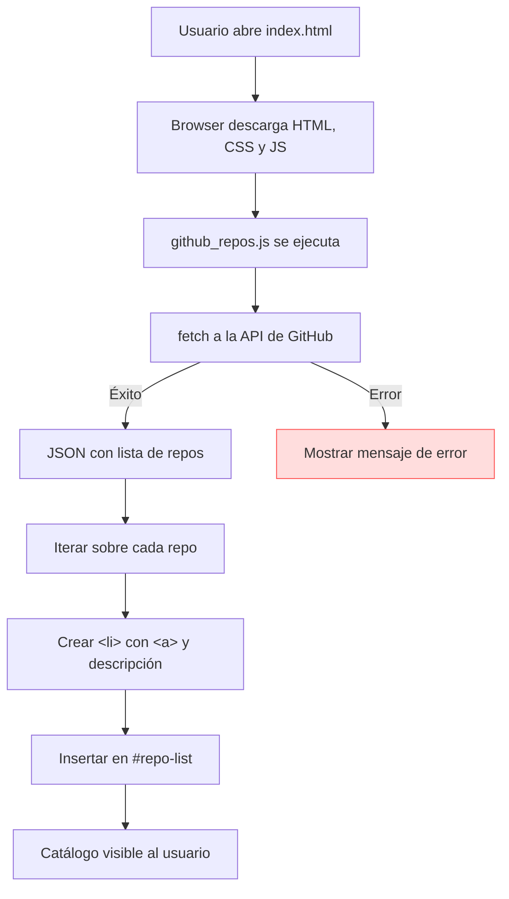
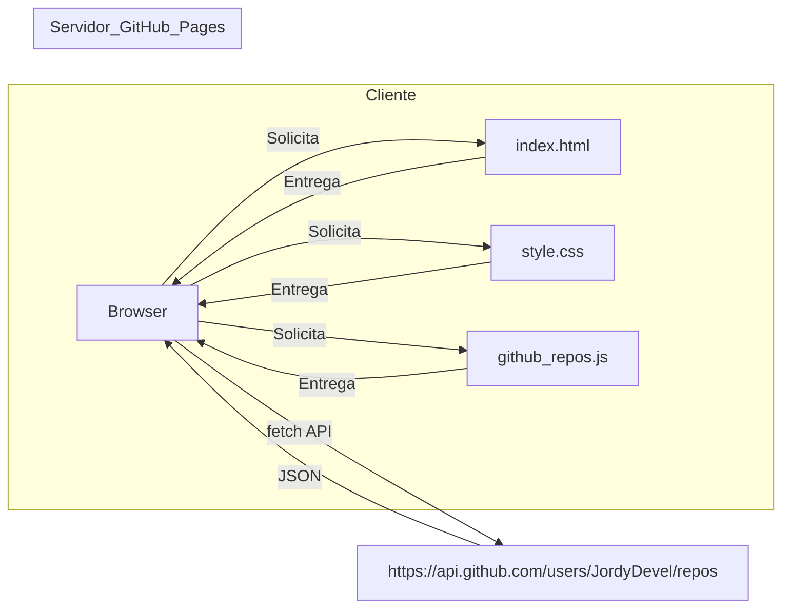

# AGENTS.md

**AGENTS.md**

# Descripción completa del proyecto  

Este repositorio contiene el código fuente de **JordyDevel.github.io**, una página web estática que muestra un catálogo de proyectos de software publicados por el usuario/organización **JordyDevel** en GitHub.  

## Propósito  

- **Visibilidad:** Listar los repositorios públicos de la cuenta de GitHub de forma automática.  
- **Simplicidad:** Utilizar únicamente HTML, CSS y JavaScript puro, sin frameworks ni servidores back‑end.  
- **Mantenimiento:** Facilitar la actualización del catálogo mediante un único script que consulta la API pública de GitHub.  

## Tecnologías utilizadas  

| Área                | Tecnologías / Herramientas                                 |
|---------------------|-------------------------------------------------------------|
| **Frontend**        | HTML5, CSS3 (sin pre‑procesadores), JavaScript ES6           |
| **Estilos**         | `assets/css/style.css` – estilos minimalistas y responsivos |
| **Lógica**           | `assets/scripts/github_repos.js` – fetch a la API de GitHub |
| **Despliegue**      | GitHub Pages (el repositorio está configurado para servir el contenido estático) |
| **Idiomas**         | Español (texto del sitio) y comentarios del código en español |

## Estructura de directorios  

```
/
├─ assets/
│   ├─ css/
│   │   └─ style.css          # Estilos globales
│   └─ scripts/
│       └─ github_repos.js     # Script que carga los repositorios
├─ projects/
│   ├─ apps-moviles.html
│   ├─ extensiones‑vscode.html
│   ├─ sdks‑moviles.html
│   ├─ microcontroladores.html
│   ├─ extensiones‑intellij.html
│   ├─ extensiones‑xcode.html
│   ├─ apis.html
│   └─ extensiones‑chrome.html
├─ privacy.html               # Aviso de privacidad
├─ terms.html                 # Términos y condiciones
├─ index.html                 # Página principal del catálogo
└─ README.md                 # (actualmente vacío)
```

## Flujo de datos principal  

1. **Carga de la página** → el navegador descarga `index.html`.  
2. El navegador procesa `<script src="assets/scripts/github_repos.js" defer></script>`.  
3. `github_repos.js` ejecuta `fetch('https://api.github.com/users/JordyDevel/repos')`.  
4. La respuesta JSON contiene la lista de repositorios.  
5. Por cada repositorio se crea un `<li>` con un enlace y (opcionalmente) la descripción.  
6. Los `<li>` se insertan dentro del `<ul id="repo-list">` y el usuario ve el catálogo actualizado.  

### Diagrama de flujo (Mermaid)



> **Nota:** El diagrama está escrito en sintaxis válida de Mermaid y se muestra sin errores de parseo en los entornos que lo soportan (por ejemplo, los previewers de VS Code o los renderizadores de GitHub).

## Diagrama de arquitectura del sitio  



## Cómo ejecutar / probar localmente  

1. **Clonar el repositorio**  

   ```bash
   git clone https://github.com/JordyDevel/JordyDevel.github.io.git
   cd JordyDevel.github.io
   ```

2. **Abrir `index.html` en un navegador**  
   - No se necesita un servidor local; basta con arrastrar el archivo al navegador o usar `open index.html`.  
   - Para evitar problemas de CORS al probar la API de GitHub, es recomendable usar un servidor estático sencillo (p.ej. `python -m http.server 8000`) y abrir `http://localhost:8000`.

3. **Verificar el catálogo**  
   - El listado de repositorios debería aparecer bajo *“Repositorios públicos disponibles”*.  
   - En caso de error (p.ej. límite de rate‑limit de la API), aparecerá el mensaje definido en `catch`.

## Extensiones y mantenimiento  

- **Cambiar el usuario de GitHub:** Modificar la constante `USER` en `assets/scripts/github_repos.js`.  
- **Añadir filtros o paginación:** Extender el script para procesar los parámetros `per_page` y `page` de la API.  
- **Estilos personalizados:** Editar `assets/css/style.css`.  
- **Contenido estático adicional:** Crear nuevas páginas dentro de `projects/` y enlazarlas desde `index.html` o desde el menú de navegación.  

---

*Este archivo está destinado a servir como referencia para cualquier persona que necesite comprender, mantener o ampliar el proyecto.*
