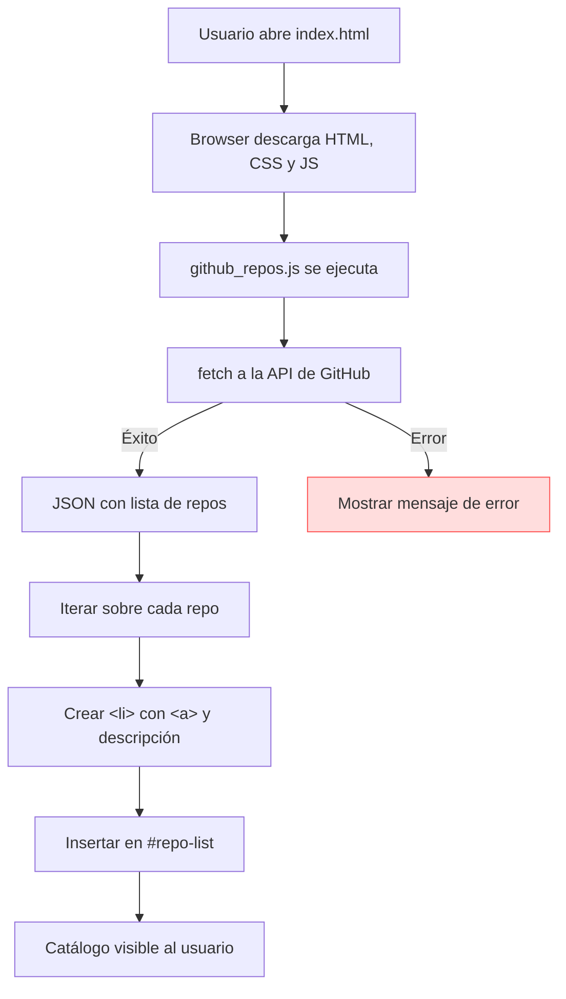
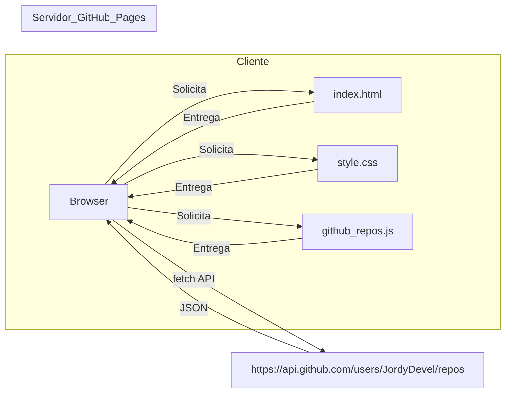

# JordyDevel.github.io


A static portfolio site that automatically lists **all public repositories** of the GitHub user **JordyDevel**. The site is pure HTML / CSS / JavaScript – no frameworks or back‑end required.

---

## ✨ What you’ll see

- A clean, responsive catalog of repositories.
- Each entry shows the name, description and a link to the repo on GitHub.
- The list refreshes automatically whenever the user adds a new repository.

---

## 📂 Project structure

```
/                     # Root of the repo (also the source of truth for AI agents)
├─ assets/
│  ├─ css/
│  │   └─ style.css           # Global stylesheet
│  └─ scripts/
│      └─ github_repos.js      # Fetches the repo list from the GitHub API
├─ projects/                  # Optional static pages for each project category
│  └─ …
├─ index.html                  # Landing page that loads the script
├─ AGENTS.md                    # AI‑agent documentation (source of truth)
└─ README.md                    # Human‑focused documentation (this file)
```

---

## 🏗️ Architecture (visual)

Below is a Mermaid diagram that shows the client‑side flow and the static hosting architecture. It is kept in **`AGENTS.md`** as the canonical source for AI agents, but we include it here for quick visual reference.





---

## 🚀 Quick start (local testing)

```bash
# Clone the repo
git clone https://github.com/JordyDevel/JordyDevel.github.io.git
cd JordyDevel.github.io

# Open locally – you can just double‑click index.html, but for the GitHub API you may hit CORS limits.
# A simple static server avoids that:
python -m http.server 8000   # or any other tool (e.g. live‑server, http-server)

# Then open http://localhost:8000 in your browser.
```

---

## 📖 Documentation

- **AI‑agent source of truth:** [`AGENTS.md`](AGENTS.md) – contains the full project description, directory layout, data‑flow diagram, and architecture diagram (kept up‑to‑date for automated agents).
- **Human‑focused guide:** This `README.md`.

---

## 🤝 Contributing

Feel free to open issues or submit pull requests if you spot a typo, want to add a new feature (e.g., pagination, theming) or improve the design.

---

## 📄 License

This project is released under the MIT License – see the `LICENSE` file for details.
